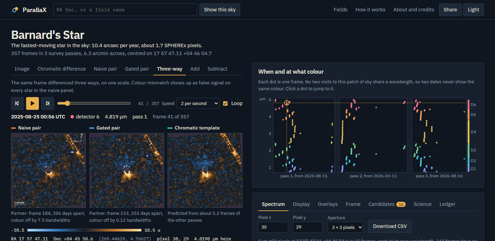
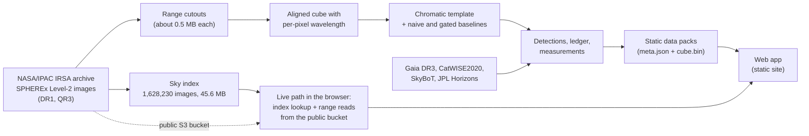
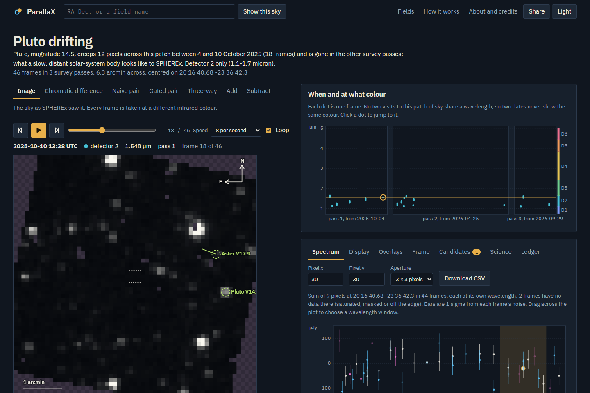

# ParallaX

**Chromatic difference imaging for the SPHEREx sky.**

ParallaX is a web tool that plays NASA's SPHEREx infrared images of any patch of sky as a
little video, so that anyone can spot things that move or change. SPHEREx never photographs
the same spot in the same colour twice, so blinking or subtracting two dates makes ordinary
stars light up as false alarms. ParallaX predicts what an unchanging sky would look like at
each frame's own colours, subtracts that prediction, and publishes measured numbers showing
how much this helps and where it does not.



*One real SPHEREx frame of Barnard's Star (detector 6, 4.819 micron) differenced three ways,
with the time-against-wavelength map of all 357 frames on the right. Screenshot of the app.*

Team ZENITH LABS, NASA Space Apps Challenge 2026, challenge "Planet X and SPHEREx", local
event Beirut. **Not affiliated with or endorsed by NASA.**

---

## Try it

The site and the repository are public:

* Site: <https://abed-r-j.github.io/parallax-spherex/>
* Code: <https://github.com/abed-r-j/parallax-spherex>
* Slides, the project demo (PDF, 7 slides): <https://github.com/abed-r-j/parallax-spherex/blob/main/presentation/ParallaX_ZENITH_LABS.pdf>
* Paper (PDF): <https://github.com/abed-r-j/parallax-spherex/blob/main/paper/ParallaX_IEEE.pdf>
* Project report (PDF): <https://github.com/abed-r-j/parallax-spherex/blob/main/docs/ParallaX_Project_Report.pdf>

You can also run it on your own computer (see [Quick start](#quick-start)); every link below
then works against `http://127.0.0.1:8000/` too.

The five challenge targets:

| Target | Link |
|---|---|
| Barnard's Star | <https://abed-r-j.github.io/parallax-spherex/?field=barnard> |
| Epsilon Indi B | <https://abed-r-j.github.io/parallax-spherex/?field=epsindi> |
| WISE 0855-0714 | <https://abed-r-j.github.io/parallax-spherex/?field=wise0855> |
| RW Aurigae | <https://abed-r-j.github.io/parallax-spherex/?field=rwaur> |
| R Draconis | <https://abed-r-j.github.io/parallax-spherex/?field=rdra> |

Two more fields show real solar-system objects in motion: the main-belt asteroid (52) Europa
crossing a fixed field in ten hours
(<https://abed-r-j.github.io/parallax-spherex/?field=europa52&seq=frames>) and Pluto, the
original "Planet X", drifting 12 pixels in 6.4 days
(<https://abed-r-j.github.io/parallax-spherex/?field=pluto&seq=frames>).

Coordinates in the URL (decimal degrees, ICRS):

```
https://abed-r-j.github.io/parallax-spherex/?ra=269.4470&dec=4.7700&fov=4
https://abed-r-j.github.io/parallax-spherex/?ra=202.4696&dec=47.1953&live=1&size=3&dets=3
```

The first lands inside a precomputed field. The second is anywhere else on the sky (here the
galaxy M51): the page fetches the images live from the public archive, in the browser.

Embed a view in another page:

```html
<iframe src="https://abed-r-j.github.io/parallax-spherex/?field=barnard&fov=4&embed=1"
        width="640" height="820" style="border:0" title="ParallaX view" loading="lazy"></iframe>
```

URL parameters (from `web/src/lib/urlstate.ts`):

| Parameter | Meaning |
|---|---|
| `field` | key of a precomputed field (`barnard`, `epsindi`, `wise0855`, `rwaur`, `rdra`, ...) |
| `ra`, `dec` | position in decimal degrees (ICRS) |
| `fov` | field of view in arcmin (0 or absent = whole field) |
| `det` | detector 1 to 6 (absent = all six) |
| `mode` | `image`, `chroma`, `naive`, `gated`, `compare` (three-way), `add`, `sub` |
| `frame` | frame number to show, counted from 0 |
| `seq` | `passes` (one stack per survey pass) or `frames` (every frame in time order) |
| `embed=1` | picture and player only |
| `live=1` | build the field at `ra`, `dec` in the browser, with `size` (arcmin: 3, 6 or 9), `dets` (for example `2,5`, or `all`) and `max` (images, default 360) |
| `st`, `cm`, `lim`, `sm`, `lam`, `ov`, `pix`, `ap` | display extras: stretch, colour map, percentile limits, smoothing, wavelength window, overlays, picked pixel, aperture |
| `engine` | address of a ParallaX engine, default `http://127.0.0.1:8000` |
| `page` | `how` or `about` |

## What makes it different

1. **It corrects colour instead of discarding frames.** Every SPHEREx exposure passes through
   a linear variable filter, so every pixel has its own wavelength and every revisit lands on
   another one. For each frame ParallaX predicts the static sky at that frame's per-pixel
   wavelength, from the spectrum each pixel showed in the other survey passes, and subtracts
   it. Against the usual fix (compare only pairs whose wavelengths match) this is 3 to 15%
   deeper in all five test fields and, at the same false-alarm rate (0.5 per frame), finds
   moving sources 1.2 to 1.9 times fainter on blank sky (Barnard's field: 563 against 1003
   microJy) and 1.1 to 1.6 times fainter next to a star.
2. **It publishes a reproducible false-alarm ledger.** Naive pair, wavelength-gated pair and
   chromatic template are run on the same real frames, with artificial sources injected and
   searched for again, and compared at a matched false-alarm rate. The limits we measured are
   published next to the results ([docs/RESULTS.md](docs/RESULTS.md), section 2.2). The work
   went through an independent adversarial review that re-ran the code; the published numbers
   are the corrected ones.
3. **Any coordinates, in the browser, with no server.** A 45.6 MB index of all 1,628,230
   public SPHEREx Level-2 images ships with the site. The page looks up which images cover
   your position and reads only the pixels it needs from the public archive bucket: 55 images
   of M51 arrive in 10 to 12 seconds on a fast connection (one to two minutes on a slow one).

## Features, mapped to the challenge

Objectives of the challenge:

| Objective | In ParallaX |
|---|---|
| Public-facing web tool | Static site on GitHub Pages, <https://abed-r-j.github.io/parallax-spherex/>; no account, no server of ours |
| Display SPHEREx images of the sky | Real Level-2 spectral images (DR1 and QR3) from NASA/IPAC IRSA |
| Enter Right Ascension and declination | Search box takes decimal degrees or sexagesimal, for example `08h55m10.831s -7d14m42.53s` |
| A series of images "like a little video" | Blink player: play, step, speed, loop; by survey pass or every frame |
| Easy to spot moving objects | Per-pass stack blink with 4x smooth display, Subtract, chromatic difference, catalogue-position marker, known-object labels |
| Tested on the five named targets | All five precomputed and measured against catalogues ([results](#results-at-a-glance)) |

Optional considerations:

| Consideration | In ParallaX |
|---|---|
| Easy to update with new data releases | `parallax fetch` downloads only new images; the sky index update fetches only new days; `parallax publish` rebuilds the packs |
| Creative display of the 102 bands | Time-against-wavelength map of every frame; per-pixel wavelength read-out; wavelength window filter; chromatic template |
| Add the data of each of the six detectors | Per-pass, per-detector stacks; detector picker |
| Spectra on the fly | Click any pixel: spectrum from every frame at its own wavelength, light curve in a wavelength window, CSV download |
| Add or subtract images from different times | Add and Subtract modes over any frame, pass or detector |
| User-chosen field of view | Field-of-view picker for the view; 3, 6 or 9 arcmin for live fields, with the download size shown before fetching |
| Overlays from other telescopes | Gaia DR3 stars moved to the frame date; CatWISE2020 sources; known solar-system objects (IMCCE SkyBoT, JPL Horizons as seen from SPHEREx) |
| Coordinates in the URL, embeddable | Every view is a URL; `embed=1`; Share button gives link and iframe code |
| Metadata such as contamination flags | Pixel-flags overlay, per-frame details (detector, wavelength, bandwidth, noise, file name, release), wavelength-mismatch tint |
| Existing public tools | Astropy in the pipeline. Aladin Lite is not used: the viewer is our own, so it runs offline |

## How it works

SPHEREx maps the whole sky every six months, and a position is typically seen in 60 to 150
frames per pass, each at a different wavelength. The pipeline asks the archive which
images cover a position and downloads only the needed pixels by HTTP range request (about
0.5 MB instead of a 65 MB file). It aligns them into one north-up cube and keeps the
wavelength of every pixel of every frame. From the other survey passes it fits, per pixel,
how brightness depends on wavelength, and from that predicts each frame; the difference is
what changed. The same frames are also differenced the two conventional ways, detections are
classified and cross-checked against known solar-system objects, and the five targets are
measured against catalogues. Everything is written into small static data packs that the web
app reads; for any other position the web app builds a simpler field itself, live.



More detail: [docs/ARCHITECTURE.md](docs/ARCHITECTURE.md), [docs/DATA_CONTRACT.md](docs/DATA_CONTRACT.md),
[docs/SKY_INDEX.md](docs/SKY_INDEX.md). A guide for non-astronomers: [docs/USER_GUIDE.md](docs/USER_GUIDE.md).

## Results at a glance

All numbers come from real SPHEREx images retrieved on 13 November 2026. The full tables,
definitions and caveats are in [docs/RESULTS.md](docs/RESULTS.md); read section 2.2 before
quoting anything.

Three ways to difference two dates (Barnard's Star field, 357 frames):

| Method | Usable frames | Depth (microJy) | False detections per frame | Flux found half the time, blank sky (microJy) |
|---|---|---|---|---|
| Naive pair | 93.6% | 38.9 | 4.44 | 1427 |
| Wavelength-gated pair | 96.4% | 33.8 | 2.40 | 1003 |
| **Chromatic template** | **100%** | **30.5** | **0.99** | **563** |

The last column, taken at a matched false-alarm rate of 0.5 per frame, is the like-for-like
comparison: across the five fields the template reaches 1.2 to 1.9 times fainter than the
gated pair on blank sky (1.1 to 2.0 for rates of 0.2 to 1 per frame). It is 3 to 15% deeper
in quoted noise and 17 to 25% deeper in the measured scatter of blank-sky residuals.

The false-detection column is **not** like for like. The template's low count comes from its
measured model-error map, which the pairs do not have; with one purely statistical sigma for
all three, the template floods as much as the pairs (33 per frame here, against 28 and 31).
At |S/N| > 5 it gives fewer false detections than the gated pair in Barnard's and RW
Aurigae's fields under every calibration we tried; in Epsilon Indi and WISE 0855 the answer
depends on the noise model, and in R Draconis (not a clean test) it has slightly more.
Depth here is over all pixels; the app's Ledger panel shows it on faint sky only (35.9 / 31.8 /
28.0 microJy for this field).

The five challenge targets:

| Target | Measured | Reference |
|---|---|---|
| Barnard's Star | 10.2 +- 0.5 arcsec/yr (scatter between the six detectors) at 356.3 +- 1.5 deg (1.65 pixels over 3 passes, from the wings of a saturated star; fit with a free annual term, one degree of freedom) | 10.36 arcsec/yr at 355.6 deg (Gaia DR3) |
| Epsilon Indi B | 4.64 +- 0.09 arcsec/yr at 122.6 +- 1.3 deg (1.02 pixels over 4 passes) | 4.70 arcsec/yr at 122.7 deg |
| WISE 0855-0714 | moving source with a combined statistic of 6.6 in pass-difference stacks of detectors 5 and 6 only, stacked along the catalogue track (not a Gaussian sigma: random tracks in the same maps scatter by 0.6, and 0 of 200 searched tracks reach it; 395 +- 69 microJy); 7.81 +- 1.57 arcsec/yr at 278.2 +- 4.3 deg with the catalogue parallax assumed (independent centroid fit: 6.2 +- 1.1) | 8.15 arcsec/yr at 274.8 deg |
| RW Aurigae | in Sep 2025, compared with Sep 2026: 0.37 +- 0.14 mag fainter at 0.75-1.1 micron and 0.76 +- 0.03 mag brighter at 4.4-5.0 micron; a control star shows no change (0.00 +- 0.02 mag) | irregular T Tauri variable |
| R Draconis | periodic change in 22 of 43 wavelength bins, median peak-to-peak 1.18 mag; free period 250 d (244 to 258 d, 95%, bootstrap; each wavelength bin spans 1.2 to 1.8 cycles) | Mira, catalogued period about 246 d |

The WISE 0855 statistic is calibrated on random tracks, not read as a Gaussian sigma.
Parallax is not measured reliably. See [Limits](#limits).

Known moving objects as ground truth: asteroid (52) Europa appears in 24 of 111 frames
(detectors 3 and 6 only) and Pluto in 18 of 46 (detector 2 only), each where JPL Horizons,
with the SPHEREx spacecraft as the observer, predicts it: on average the measured centre
differs from the prediction by 0.05 +- 0.04 pixel for Europa and 0.03 +- 0.10 pixel for Pluto.
Without the ephemeris, the classifier itself calls 21 of Europa's 24 detections a mover and
the linker recovers its track blind (28.3 arcsec per hour at position angle 89.2 deg; the
ephemeris says 28.5 at 89.1). Before a fix made after the independent review it called only
2 of 24 a mover. Pluto moves too slowly (0.7 arcsec per hour) for a blind track: the
classifier calls 8 of its 18 detections a mover and 8 a variable, and only the ephemeris
names it.



## Quick start

Requirements: Python 3.11 or newer with [uv](https://docs.astral.sh/uv/), and Node.js 22 or
newer with npm. Commands are written for a POSIX shell; on Windows PowerShell they are the
same with `\` in paths.

### (a) Just look at it

```bash
git clone https://github.com/abed-r-j/parallax-spherex   # about 100 MB: the data packs are in the repository
cd parallax-spherex/web
npm install
npm run build                 # writes web/dist
cd ../pipeline
uv sync                       # creates pipeline/.venv and installs the "parallax" command
uv run parallax serve         # open http://127.0.0.1:8000  (Ctrl+C to stop)
```

`parallax serve` serves the web app and the published data packs and also acts as the live
engine. If you only want the static site, any static server will do:

```bash
python -m http.server 8000 --directory web/dist
```

The precomputed fields work offline. Live fields need the internet.

### (b) Build a field for any coordinates

```bash
cd pipeline
uv run parallax targets                                   # fields this installation knows
uv run parallax fetch m51 --ra 202.4696 --dec 47.1953 --name "M51" --size-arcmin 6.25
uv run parallax publish m51                               # writes web/public/data/m51/
```

`fetch` options: `--ra`, `--dec` (degrees, ICRS), `--name`, `--size-arcmin` (default 6.25),
`--max-images` (cap, evenly spaced in time), `--mirror irsa|s3`, `--threads` (default 6).
`publish` options: `--injection` (re-run the injection-recovery tests, slow), `--offline`
(skip catalogue and solar-system lookups), `--rebuild` (rebuild the aligned cube).
Then `npm run build` in `web/` to include the new pack in the static site; `parallax serve`
picks it up without a rebuild. A field takes a few minutes: the archive is the bottleneck
(358 images of one field took 13 minutes).

The same thing happens through the page when a `parallax serve` engine is running: type
coordinates outside the precomputed fields and choose "Build this field with the engine".

### (c) Update to a new SPHEREx data release

```bash
cd pipeline
uv run parallax fetch barnard            # incremental: only images not already on disk
uv run parallax publish barnard          # rebuild that pack (no argument: every field with data)
uv run python scripts/build_sky_index.py # fetch only the new days, rebuild web/public/skyindex
cd ../web && npm run build               # writes web/dist with the new packs and index
cd .. && powershell -File web/scripts/publish_site.ps1 -Push   # publishes web/dist as the gh-pages branch
```

The site is served from the `gh-pages` branch, which holds the contents of `web/dist`;
`web/scripts/publish_site.ps1` writes that branch and, with `-Push`, pushes it. Commit the
changed packs under `web/public/data` to the main branch as well: they are tracked in git,
so a clean clone builds and tests the web app without running the pipeline. Tests are run
locally with the commands under [Testing](#testing); a GitHub Actions workflow that runs the
same tests is provided and is started by hand (it does not run on push and does not deploy).

`build_sky_index.py` is resumable (`--skip-dump` builds from what is cached, `--verify`
compares with the live archive). The first full download took about 73 minutes; an update
only fetches days that are missing.

### Reproduce the numbers

```bash
cd pipeline
uv run python scripts/run_ledger.py        # three-way comparison -> data/ledger/*.json
uv run python scripts/run_validation.py    # target measurements  -> data/science/*.json
```

Two to four minutes per field on a laptop. Both scripts take field keys as arguments (for
example `run_ledger.py barnard`); they have no `--help` and start working at once.

## Repository layout

```
pipeline/                 Python package "parallax" (installs with uv)
  src/parallax/
    irsa.py               archive queries and range-request cutouts
    frames.py             aligned cube with per-pixel wavelength
    template.py           chromatic template
    diffim.py             naive, gated and chromatic differences
    detect.py, inject.py  detection, classification, injection-recovery
    ledger.py             the three-way ledger
    photometry.py, motion.py, lightcurve.py, validate.py   target measurements
    catalogs.py, sso.py, movers.py   Gaia, CatWISE, SkyBoT, Horizons, moving-object fields
    skyindex.py           static index of every public image
    export.py, publish.py data packs
    server.py, cli.py     local engine and command line
  scripts/                run_ledger, run_validation, build_sky_index, find_mover_fields, fetch_targets
  tests/                  offline tests with recorded real responses
web/                      Vite + React + TypeScript static site
  src/lib/                decoding, WCS, FITS, sky index, live fetch, photometry, URL state
  src/components/         viewer, charts, panels, live fetch
  public/data/            published data packs (tracked in git, about 100 MB)
  public/skyindex/        sky index shards
  scripts/                screenshot and live checks (headless Chrome), publish_site.ps1
docs/                     results, architecture, guides, submission material
.github/workflows/ci.yml  tests for both halves, started by hand (the site is published from the gh-pages branch)
data/                     local working data (the only git-ignored data folder)
```

## Testing

```bash
cd pipeline && uv run pytest -q     # 130 passed, 2 skipped (network tests; set PARALLAX_NETWORK=1 to run them)
cd pipeline && uv run ruff check src scripts tests
cd web && npm test                  # vitest: 55 passed
cd web && npm run lint && npm run build
```

All 185 default tests run offline, on synthetic data and on recorded real service responses.
Counts as run on 14 November 2026.

## Data sources and acknowledgements

This publication makes use of data products from the Spectro-Photometer for the History of
the Universe, Epoch of Reionization and Ices Explorer (SPHEREx), which is a joint project of
the Jet Propulsion Laboratory and the California Institute of Technology, and is funded by
the National Aeronautics and Space Administration.

This research has made use of the NASA/IPAC Infrared Science Archive, which is funded by the
National Aeronautics and Space Administration and operated by the California Institute of
Technology.

* SPHEREx Level-2 spectral images: Data Release 1, doi:[10.26131/IRSA678](https://doi.org/10.26131/IRSA678),
  and Quick Release 3, doi:[10.26131/IRSA662](https://doi.org/10.26131/IRSA662), retrieved
  from NASA/IPAC IRSA on 13 November 2026. Mission paper: Bock et al. 2026, ApJ 999, 139,
  doi:10.3847/1538-4357/ae2be2.
* Star positions and proper motions: ESA Gaia Data Release 3 (European Space Agency Gaia
  mission, processed by the Gaia Data Processing and Analysis Consortium).
* Infrared sources: CatWISE2020, served by NASA/IPAC IRSA.
* Known solar-system objects: SkyBoT, IMCCE, Observatoire de Paris (Berthier et al. 2006).
* Ephemerides as seen from SPHEREx: NASA/JPL Solar System Dynamics. Data retrieved on 13
  November 2026. Horizons System. <https://ssd.jpl.nasa.gov>. Positions are used unmodified;
  they are converted to pixel coordinates of our grids.
* The idea of a browser blink tool for citizen scientists follows WiseView and the Backyard
  Worlds project, named as inspiration in the challenge resources.

Use of these data does not imply endorsement by NASA, JPL, Caltech, IPAC, ESA or IMCCE.

## Licences

Code: [Apache-2.0](LICENSE). Fonts: IBM Plex Sans and IBM Plex Mono, SIL Open Font License
1.1, bundled with the site. Every dependency and data source with its licence or terms:
[THIRD_PARTY_LICENSES.md](THIRD_PARTY_LICENSES.md). Attributions: [NOTICE](NOTICE). How to
cite: [CITATION.cff](CITATION.cff).

## Use of SI

NASA Space Apps 2026 calls AI "Super Intelligence (SI)" and asks for disclosure. The
team chose the challenge, the goal and the direction: a comparison of SPHEREx dates that
accounts for the changing wavelength. The specific method (a per-pixel chromatic template
checked against two baselines) was worked out with the SI assistant (Claude, by Anthropic),
which also surveyed existing tools, wrote the code and drafted the documents under the team's
direction. The team reviewed the work, ran it and is responsible for it. All results are computed by the project's own code
from real SPHEREx data. No SI-generated images, video, voices or faces are used. Details:
[docs/SI_DISCLOSURE.md](docs/SI_DISCLOSURE.md).

## Team

ZENITH LABS, Beirut:

* **Abed El Rahmane Jaafir**, team lead. AI engineer; MEng Software Engineering and
  currently Master in AI, Saint Joseph University of Beirut.

Former member: Mohamad Alayli (until 14 November 2026).

Development began on 12-13 November 2026, before the on-site hackathon of 14-15 November,
after the local organizers allowed early preparation.

## Limits

* **Planet X is the motivation, not a claim.** A real Planet Nine would be far too faint for
  single SPHEREx frames. ParallaX shows the method on objects that are there: fast stars,
  variables, and known solar-system objects.
* **The template wins on depth and on sensitivity at a matched false-alarm rate, not on
  rescued frames.** 96 to 99% of frames already find a wavelength-matched partner in ordinary
  fields. Next to a star, at a strict rate of 0.2 false alarms per frame, it has no advantage.
* **A raw count of false alarms is not a fair comparison.** The template's low count rests on
  its measured model-error map; under one statistical sigma it floods like the pairs.
* **The false-alarm tail is not Gaussian noise**: artefacts of saturated stars and
  transients the archive did not flag dominate it, so the matched-rate thresholds are 8 to 12
  sigma.
* **Registration** is good within a pass (0.16 arcsec rms) but pass-to-pass offsets of up to
  0.1 pixel are not corrected in the differencing.
* **For a star that shifts one or two pixels, a pair or a per-pass stack shows the motion
  better than the template.** Both lobes exceed 5 sigma in 69% of Barnard frames for the
  gated pair against 17% for the template. The app therefore defaults to blinking per-pass
  stacks for such stars.
* **Pixel sampling is the largest noise term.** SPHEREx pixels are 6.15 arcsec; the peak
  pixel of a bright star scatters by 23 to 27% from frame to frame.
* **Parallax is not measured reliably**, and bright targets saturate (Barnard's Star in 99%
  of frames, R Draconis in 97%, RW Aurigae in 39%); their fluxes are relative.
* **R Draconis is not a clean test** of the differencing methods.
* **The template does not pass its own known-target test.** In the ledger's "known target
  recovered" row it scores "no" for Barnard's Star: its detection sits next to the saturated
  core and is classed an artifact in 85% of frames. RW Aurigae's change exceeds 5 sigma in
  39% of template frames against 86% for the gated pair.
* **Live fields are simpler than pipeline packs:** one sky level per frame, no flag masking,
  no chromatic template, ledger, candidates or catalogue overlays.
* **WISE 0855-0714 is invisible in single frames**; it appears only in stacks of detectors 5
  and 6, with a statistic calibrated on random tracks.

Contributions and false-alarm reports are welcome: [CONTRIBUTING.md](CONTRIBUTING.md).
