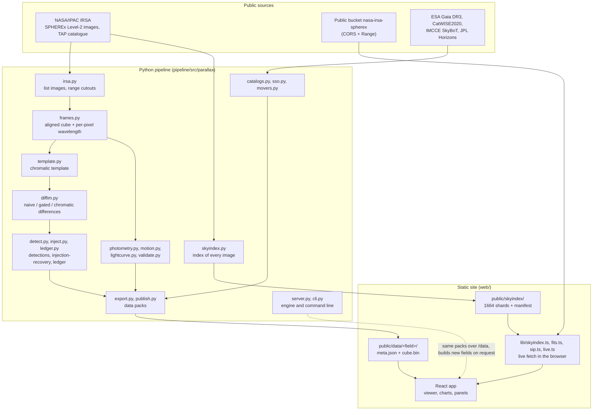

# ParallaX architecture

This page describes the parts of ParallaX, how data flows between them, why they are built
the way they are, how fast they are, and how they fail. Numbers are from
[RESULTS.md](RESULTS.md) and the build reports; nothing here is an estimate unless it says so.

## 1. The two halves and the contract between them

* The **pipeline** does everything that needs many images at once or a catalogue service. It
  writes one folder per field.
* The **web app** only reads files. The single agreement between the two is
  [DATA_CONTRACT.md](DATA_CONTRACT.md): `index.json`, and per field `meta.json` (everything
  except pixels) and `cube.bin` (pixels in fixed binary sections).
* The **sky index** ([SKY_INDEX.md](SKY_INDEX.md)) is a second, independent static product:
  a list of every public SPHEREx image, small enough to ship with the site.

## 2. Components

### Pipeline

| Module | What it does |
|---|---|
| `irsa.py` | Asks IRSA which Level-2 images cover a position, then reads only the needed pixels of each 65 MB file by HTTP range request (about 0.5 MB per image). Resumable and incremental: images already on disk are skipped. |
| `frames.py` | Resamples each cutout onto one north-up, east-left grid of 6.15 arcsec pixels, removes the zodiacal-light model and a residual sky level, and stores for every frame the wavelength of every pixel (as a plane fit across the field), the detector, the survey pass and the pixel flags. |
| `template.py` | For every pixel, fits brightness against wavelength over the frames of the *other* survey passes (weighted local-linear fit, Gaussian kernel that starts at half a bandwidth and widens until at least four effective references are found). Evaluates that fit at the target frame's own per-pixel wavelength. Carries an empirical model-error map measured inside each reference pass. |
| `diffim.py` | Produces the three differences for every frame: naive pair, wavelength-gated pair, chromatic template; each with a noise map and a signal-to-noise map. |
| `detect.py` | Finds connected residuals above threshold, classifies them (`mover`, `variable`, `motion-dipole`, `chromatic`, `star-residual`, `artifact`) with a reason, vetoes cosmic rays using the exposure of the same detector about two minutes later, and links detections on straight lines. |
| `inject.py`, `ledger.py` | Add artificial point sources to the real frames, search for them again, and write the three-way ledger: usable frames, depth, false detections, completeness. |
| `photometry.py`, `motion.py`, `lightcurve.py`, `validate.py` | Measure the five challenge targets: sub-pixel positions per pass and detector, proper motion, matched-wavelength brightness ratios, period scans. |
| `catalogs.py`, `sso.py`, `movers.py` | Gaia DR3 and CatWISE2020 cone searches; known solar-system objects from SkyBoT, refined with JPL Horizons as seen from the SPHEREx spacecraft; object-first search for fields that contain a known mover. Every answer is cached on disk. |
| `export.py`, `publish.py` | Encode the cube (16-bit asinh for images, 8-bit for signal-to-noise), write `meta.json`, `cube.bin`, a thumbnail and `index.json`. |
| `skyindex.py` | Downloads the IRSA image catalogue day by day and packs it into 28-byte records in sky-cell shards. |
| `server.py`, `cli.py` | `parallax serve` serves the built site and the packs and builds new fields on request (`POST /api/field`, progress at `GET /api/job/<id>`); `parallax fetch`, `publish`, `targets`. |

### Web app

| Part | What it does |
|---|---|
| `lib/decode.ts`, `types.ts` | Typed-array views over `cube.bin`, brightness look-up table, signal-to-noise decoding. |
| `lib/wcs.ts`, `coords.ts` | Tangent-plane coordinates both ways, proper-motion propagation, parsing of decimal and sexagesimal coordinates. |
| `lib/stretch.ts`, `products.ts` | Percentile limits, asinh / linear / log stretches, three colour maps, 4x bicubic display; the three differences, Add, Subtract, mismatch map, flags overlay. |
| `lib/photometry.ts` | Per-pixel wavelength, aperture sums, spectrum and light curve, CSV. |
| `lib/urlstate.ts` | The whole view state as a URL and back. |
| `lib/skyindex.ts`, `fits.ts`, `sip.ts`, `live.ts`, `liveStore.ts` | The live path: read the index shards for a position, read header, pixel rows and wavelength table of each image from the public bucket, apply the TAN-SIP coordinates, resample, and hand frames to the viewer as they arrive. |
| `components/` | Home, viewer with blink player, sky canvas with overlays, hand-written SVG charts, side panels (Spectrum, Display, Overlays, Frame, Candidates, Science, Ledger), live fetch, How it works, About. |

## 3. Data flow for the three ways to use it

1. **Precomputed field** (`?field=barnard`). The browser loads `index.json`, then that field's
   `meta.json` and `cube.bin` (10 to 18 MB for the five challenge fields). No other request is
   made; the site works offline.
2. **Any coordinates, live** (`?ra=..&dec=..&live=1`). The browser reads about four index
   shards (about 0.1 MB at ordinary positions), tests exactly which image footprints contain
   the point, then for each image reads the FITS header (28.8 kB), one contiguous range of
   detector rows, and once per detector calibration the 5.76 kB wavelength table. At most five
   requests run at a time, with retries. Frames appear as they arrive. The result has frames,
   per-pass stacks, spectra, Add, Subtract and browser-computed naive and gated differences.
3. **Any coordinates, full pipeline** (`parallax serve`). The page asks the engine at
   `http://127.0.0.1:8000`; the engine downloads cutouts, runs the whole pipeline including
   the chromatic template and the catalogue overlays, and serves the new pack. This takes
   several minutes per field.

## 4. Key design decisions and their reasons

| Decision | Reason |
|---|---|
| **Static site, no hosted server** | No running cost and nothing to keep alive after the hackathon. We found no free host for a Python API; a static site can be hosted free on GitHub Pages. The precomputed fields make the demo independent of the archive's speed. |
| **Read pixels by HTTP range request** | A Level-2 image is 65 MB; a 6 arcmin field needs about 0.5 MB of it. Pixels are identical to the IRSA cutout service. |
| **Ship an index of every image with the site** | A browser cannot query IRSA: its services send no CORS headers. The public bucket does allow cross-origin range reads, but a bucket cannot answer "which files cover this position". The index answers that without a server. |
| **Correct colour with a template instead of gating pairs** | Gating needs a partner frame at nearly the same wavelength; the template needs none and uses every other-pass frame near that wavelength, so it averages down noise (about 5 to 6 effective references) and uses 100% of frames in ordinary fields. |
| **Template built only from other passes** | A source that is present in the frame's own pass must not be subtracted from itself. Single-pass fields fall back to leaving out the frame's own visit. |
| **Empirical model error, measured within each reference pass** | SPHEREx pixels under-sample the image, so a bright star's pixel values scatter by 23 to 27% at fixed wavelength. A purely statistical noise model floods with false detections (Barnard's field: 28.70 per frame for the naive pair). Measuring the scatter within a pass keeps real pass-to-pass change visible. |
| **Give every method the same "star noise" term in the ledger** | Otherwise the comparison would flatter the template. The plain-noise numbers are published too. |
| **Compare at a matched false-detection rate** | "How faint can you go" only means something at equal false alarms; each method's threshold is tuned to 0.5 false detections per frame. |
| **Do not mask the archive's OUTLIER flag** | The flag marks real movers: on asteroid (52) Europa 757 of 1500 box pixels carry it. Masking it would erase the objects the tool is for. |
| **Positions of known objects as seen from SPHEREx, rates geocentric** | Horizons supports the spacecraft as an observer; predicted and measured positions agree to 0.05 pixel for (52) Europa. The rate seen from the spacecraft wobbles with its 98-minute orbit, so the stable geocentric rate is stored. |
| **Default to per-pass stack blink for nearby stars** | Their shift is one to two pixels; stacks are cleaner than single frames and a pair shows the two-lobe signature better than the template. |
| **Differences drawn in exact pixels, images in 4x smooth** | Smoothing a noisy difference makes noise look like sources; smoothing an image makes a sub-pixel shift visible. |
| **Own FITS, WCS and chart code in the browser; bundled fonts; no CDN** | The site must work offline on a demo laptop and make no outside request for the precomputed fields. |
| **Every view is a URL** | Sharing, embedding, and reproducible bug or false-alarm reports. |
| **JPL services called only by the pipeline** | JPL's terms forbid embedding its APIs in a website and it sends no CORS headers; answers are cached in the packs. |

## 5. Performance (measured)

| What | Number |
|---|---|
| Cutout by range request | about 0.5 MB per image instead of 65 MB; 358 images of one field in 13 minutes from IRSA |
| Aligned cube and template | chromatic template for 357 frames of 61 x 61 pixels in 33.9 s |
| Full ledger with injection tests | two to four minutes per field (i7-11800H laptop) |
| Target measurements | about 35 s for all five targets |
| Publish one field without injection | about 45 s |
| Sky index build | 1,628,230 images; 601 MB of catalogue rows downloaded in about 73 minutes (first time; updates fetch only new days); result 45.6 MB in 1664 shards plus a 92 kB manifest; median shard 22 kB |
| Sky index query | about 4 shards, about 0.1 MB, at ordinary positions; zero misses against the live archive at six test positions |
| Live field in the browser | M51, 3 arcmin, detector 3: 55 images, 21.4 MB, 111 requests, 10 to 12 s on a fast connection (viewer usable after 3 to 5 s); COSMOS, detectors 2 and 5: 78 images, 28.2 MB, 11.7 s; one to two minutes on a slow connection |
| Agreement of browser and pipeline | resampled pixels within 2e-4 relative; wavelength within 5e-6 micron; TAN-SIP positions within 1e-6 pixel of Astropy |
| Data pack size | 10.2 to 17.8 MB of pixels per challenge field |
| Web bundle | about 357 kB of JavaScript before compression |
| Tests | 120 Python and 55 TypeScript, all offline |

## 6. Failure modes and what happens

| Failure | Effect | What the system does |
|---|---|---|
| No internet | Live fields and the engine's downloads fail | Precomputed fields keep working fully; a live fetch reports the failed images and offers to try again |
| Archive slow or returning errors | Live fetch is slow | Estimated size and time are shown before fetching; frames appear as they arrive; Stop and "Fetch the rest" buttons; retries with back-off; failed images are counted and reported |
| Position never observed, or newer than the index | Nothing to fetch | The page says SPHEREx has no image of this position in the index and gives the index date |
| Catalogue service down (Gaia, CatWISE, SkyBoT, Horizons) | Missing overlay | The pipeline never stops for it: the block is left empty, the reason is logged, the app says the overlay is "not in this field's data yet". Gaia falls back from ESA to IRSA's copy; CatWISE falls back to AllWISE |
| A pack lacks optional sections (template, signal-to-noise, partner lists) | Some modes unavailable | The app computes pair differences itself and labels them as browser-computed, and explains why the chromatic view is missing |
| Saturated star | Blank core, unreliable flux | Flux comes from the wings and is labelled relative; the spectrum panel says how many frames have no data and suggests a wing pixel |
| Too few reference frames for a pixel | No prediction | The template is left undefined there (shown as no data) instead of guessing |
| Fast or unlisted solar-system object | Not labelled | SkyBoT groups allow up to 120 arcsec/h and objects fainter than V 20.5 are dropped; an unlabelled mover is therefore not proof of a new object |
| Engine not running | "Build with the engine" unavailable | The page reports that no engine answered and offers the live route and the nearest ready fields |
| Windows Smart App Control blocks a new binary | The pipeline may not start on the demo laptop | The static site needs no Python at all; see [DEMO_RUNBOOK.md](DEMO_RUNBOOK.md) |

## 7. Updating with new data

* `parallax fetch <field>` downloads only images that are not yet on disk; `parallax publish
  <field>` rebuilds the pack.
* `pipeline/scripts/build_sky_index.py` fetches only the days that are missing and rebuilds
  the shards.
* Pushing to the main branch runs the tests and deploys the site (GitHub Actions).

## 8. Known limits of the design

* Live fields are deliberately simpler than pipeline packs (one sky level per frame, no flag
  masking, no template, no ledger, no overlays).
* Fields are small cutouts (6 arcmin by default, up to 12 arcmin through the engine, 9 arcmin
  live), so a main-belt asteroid crosses one in hours; linking over many visits is rare.
* The template models colour but not the sub-pixel position of each exposure, which is the
  largest remaining noise term.
* Precomputed fields are frozen at the date they were built; the index and packs must be
  rebuilt to see newer data.
