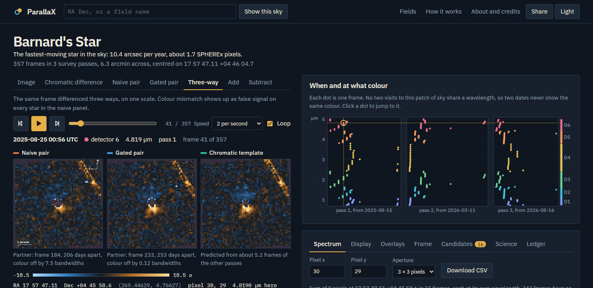
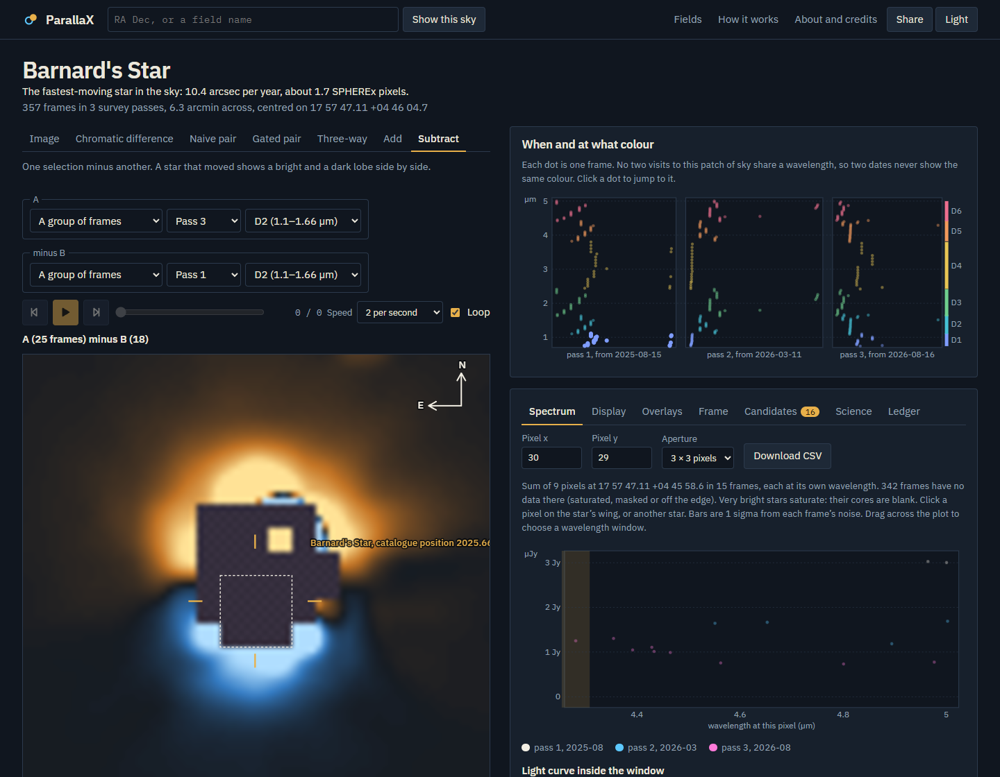
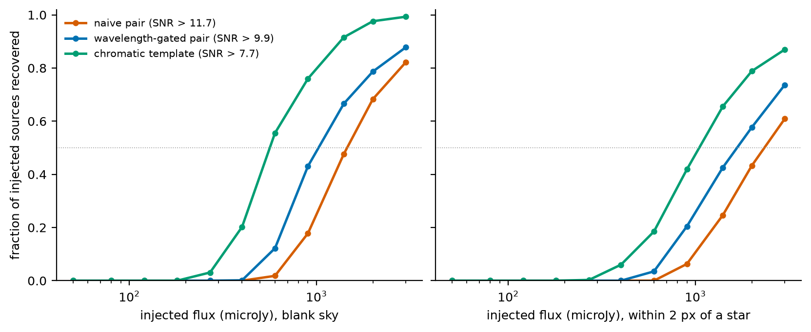
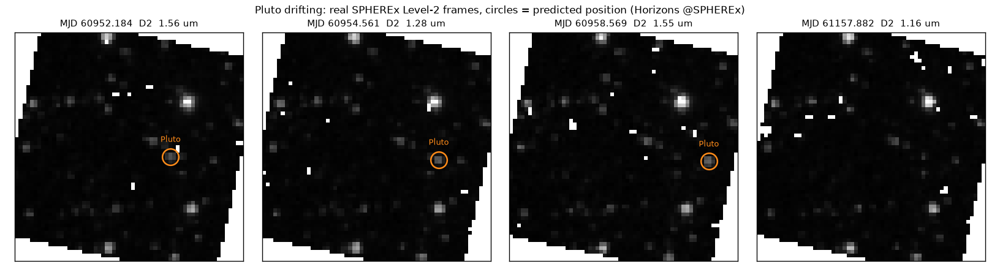

# ParallaX: chromatic difference imaging for the SPHEREx sky

**Project report. NASA Space Apps Challenge 2026, challenge "Planet X and SPHEREx", local
event Beirut. Team ZENITH LABS. 14 November 2026.**

*Not affiliated with or endorsed by NASA.*

## 1. Team details

| | |
|---|---|
| Team | ZENITH LABS (Beirut, Lebanon) |
| Member | **Abed El Rahmane Jaafir**, team lead: AI engineer; MEng Software Engineering and currently Master in AI, Saint Joseph University of Beirut. |
| Former member | Mohamad Alayli (until 14 November 2026) |
| Challenge | Planet X and SPHEREx (Advanced; astrophysics, planets and moons, software) |
| Project | ParallaX, a web tool and an open pipeline |
| Site and code | Live site: https://abed-r-j.github.io/parallax-spherex/ . Source code: https://github.com/abed-r-j/parallax-spherex |
| Licence | Apache-2.0 |
| Timeline | Development began on 12-13 November 2026, before the on-site event of 14-15 November, after the local organizers allowed early preparation. |

## 2. Challenge and problem statement

**The challenge.** NASA's SPHEREx mission has been mapping the whole sky every six months
since 2025, in 102 bands of near-infrared light. The challenge asks for a public web tool
that displays SPHEREx images of any patch of sky as a series, "like a little video", so that
anyone can quickly see how the sky changes and spot moving objects. Users enter Right
Ascension and declination. The tool must be tested on Barnard's Star, Epsilon Indi B, WISE
0855 and the variable stars RW Aurigae and R Draconis. Pluto, the original "Planet X", was
found exactly this way: by blinking two photographs.

**The catch we found.** SPHEREx never photographs the same spot in the same colour twice.
Each exposure passes through a linear variable filter, a filter whose wavelength changes
smoothly across the detector. Every pixel therefore has its own wavelength, and every
revisit of a star lands on another one. In the map in Figure 1 each dot is one image of
Barnard's Star: no two share a wavelength.

Two more facts make it harder. SPHEREx pixels are coarse (6.15 arcsec), so the pixel values
of a star jitter by about a quarter from frame to frame. And the challenge's own test stars
move by only one to two pixels over the whole survey so far.

**The consequence.** Blink or subtract two dates naively and ordinary stars light up as
false alarms, while the real signal is tiny. The usual fix is to compare only pairs of
images whose wavelengths happen to match. We did not find a published measurement of how
many false alarms each approach leaves on real SPHEREx frames.

*Figure 1. Screenshot of ParallaX. Left: one frame of Barnard's Star (detector 6, 4.819
micron) minus a naive partner, minus a wavelength-matched partner, and minus our chromatic
template. Right: every frame of the field as a dot; height is wavelength.*

## 3. Proposed solution

### What a user sees first

A home page with a search box and ready fields. Type coordinates in any usual notation, for
example `08h55m10.831s -7d14m42.53s`, or click a target. The field opens as a player: press
play and the survey passes blink, six months apart. Around the picture:

* seven views: Image, Chromatic difference, Naive pair, Gated pair, Three-way, Add, Subtract;
* a map of when and at what wavelength every image was taken;
* a click on any pixel gives its spectrum, built on the fly from every image;
* overlays: Gaia DR3 stars moved to the date of the image, CatWISE sources, contamination
  flags, known asteroids;
* a Ledger panel with the measured false-alarm numbers for that field;
* a Share button: every view is a link and can be embedded with `embed=1`.

For coordinates outside the ready fields the page says how many times SPHEREx photographed
that spot and fetches the images itself, in the browser, from NASA's public archive. No
server of ours is involved.

*Figure 2. Subtract view (screenshot). The latest survey pass minus the first, detector 2.
Barnard's Star leaves a bright lobe to the north, where it is now, and a dark lobe to the
south, where it was. The square is its saturated core.*

### How it works

1. **Any coordinates, no server.** We built a static index of all 1,628,230 public SPHEREx
   Level-2 images: 45.6 MB, shipped with the site. The browser looks up which images cover a
   position and reads only the pixels it needs from the public archive bucket by HTTP range
   request.
2. **A chromatic template.** For every frame, the pipeline predicts what a static sky would
   look like at that frame's own per-pixel wavelength, using the spectrum each pixel showed
   in the *other* survey passes, and subtracts it. At the same false-alarm rate, fainter changes then stand out. The template also
   carries a measured map of its own error.
3. **A three-way ledger.** The same real frames are differenced three ways: naive pair,
   wavelength-gated pair, chromatic template. Artificial moving sources are injected into
   the real frames and searched for again, and all three methods are compared at the same
   false-alarm rate.
4. **Ground truth.** Known asteroids are predicted with JPL Horizons as seen from the SPHEREx
   spacecraft itself and with IMCCE SkyBoT, and the five targets are measured against
   catalogues.

The pipeline writes small static data packs; the website only reads files. That is why the
site needs no server and works offline for the ready fields.

## 4. Data, software, methods and tools

**Data.**

* SPHEREx Level-2 spectral images, Data Release 1 (doi:10.26131/IRSA678) and Quick Release 3
  (doi:10.26131/IRSA662), from the NASA/IPAC Infrared Science Archive, retrieved on 13
  November 2026: 1,991 frames in the five challenge fields, plus two fields with solar-system
  objects.
* ESA Gaia Data Release 3: star positions and motions.
* CatWISE2020 (NASA WISE and NEOWISE), served by IRSA: infrared sources.
* IMCCE SkyBoT and NASA/JPL Horizons: known solar-system objects.

**Methods.**

* *Cutouts by range request*: about 0.5 MB per image instead of the 65 MB file, with pixels
  identical to the archive's cutout service.
* *Aligned cube*: every image resampled to one north-up grid, keeping the wavelength of
  every pixel, the detector, the survey pass and the flags.
* *Chromatic template*: per pixel, a weighted local fit of brightness against wavelength
  over the other passes, with a kernel that starts at half a filter bandwidth and widens
  until enough reference frames are found.
* *Noise model*: the same background and noise scale for all three methods and a fitted
  "star noise" term; the template also carries its own measured model-error map, which the
  pairs do not have. Sensitivity is therefore compared at a matched false-alarm rate.
* *Detection and vetting*: connected residuals above 5 sigma; classes with a stated reason;
  a cosmic-ray veto that uses the exposure taken about two minutes later.
* *Injection and recovery*: artificial point sources added to real frames, on blank sky and
  next to stars.
* *Measurements*: sub-pixel positions per pass and detector, proper motion, brightness
  ratios at matched wavelength, period scans.

**Software and tools.** Python 3 with NumPy, SciPy, Astropy, HTTPX, FastAPI and Typer;
TypeScript, React and Vite for the site; pytest and Vitest (130 Python and 55 TypeScript
tests, all offline, run locally; a GitHub workflow that runs them can be started by hand);
GitHub Pages for the site. The FITS reader, the coordinate code
and the charts in the browser are our own, and fonts are bundled, so the site makes no
outside request for the ready fields. Hardware: one laptop. An SI coding assistant was used
under our direction (section 12).

## 5. Results and validation

Every number is from real SPHEREx images and can be regenerated with two scripts in two to
four minutes per field. Definitions and caveats are in `docs/RESULTS.md`.

**Three ways to difference two dates.**

| Field | Method | Usable frames | Depth (microJy) | False detections per frame | Flux found half the time, blank sky (microJy) |
|---|---|---|---|---|---|
| Barnard's Star | naive | 93.6% | 38.9 | 4.44 | 1427 |
| | gated | 96.4% | 33.8 | 2.40 | 1003 |
| | **chromatic** | **100%** | **30.5** | **0.99** | **563** |
| Epsilon Indi B | naive | 100% | 28.4 | 2.51 | 955 |
| | gated | 99.3% | 25.3 | 2.34 | 808 |
| | **chromatic** | **100%** | **24.5** | **2.09** | **571** |
| RW Aurigae | naive | 100% | 30.4 | 3.28 | 1014 |
| | gated | 99.4% | 30.2 | 2.54 | 1150 |
| | **chromatic** | **100%** | **25.8** | **1.28** | **593** |
| WISE 0855-0714 | naive | 100% | 27.5 | 3.54 | 2193 |
| | gated | 98.8% | 19.1 | 2.21 | 859 |
| | **chromatic** | **99.6%** | **18.0** | **1.64** | **707** |
| R Draconis | naive | 100% | 147.4 | 0.49 | 1793 |
| | gated | 79.0% | 106.8 | 0.58 | 1743 |
| | chromatic | 97.1% | 103.1 | 0.61 | 1136 |

False detections are residuals above 5 sigma with at least two pixels, outside 14 pixels of
the known target, per usable frame. The last column is measured at a threshold tuned so that
every method gives 0.5 false detections per frame. Depth is over all pixels; the app's
Ledger panel shows it on faint sky only.

* The template is 3 to 15% deeper than the gated pair in every field in quoted noise, and 17
  to 25% deeper in the measured scatter of blank-sky residuals.
* At the same false-alarm rate (0.5 per frame) it finds moving sources 1.2 to 1.9 times
  fainter on blank sky (Barnard's field: 563 against 1003 microJy) and 1.1 to 1.6 times
  fainter next to a star. For rates of 0.2 to 1 per frame the blank-sky factor is 1.1 to 2.0
  and the ranking never flips; next to a star the advantage is gone at 0.2 per frame.
* The false-detection column is not like for like. The template's low count comes from its
  measured model-error map; with one purely statistical sigma for all three it floods as
  much as the pairs (Barnard's field: 27.55 / 31.38 / 32.98 per frame). At 5 sigma it gives
  fewer false detections than the gated pair in Barnard's and RW Aurigae's fields under
  every calibration we tried; in Epsilon Indi and WISE 0855 it depends on the noise model;
  in R Draconis it has slightly more.
* A stronger simple baseline, the weighted mean of all wavelength-matched frames, does not
  beat the template (733 / 821 / 894 against 563 / 593 / 707 microJy in three fields).
* The shortcut used for the injection test was checked against a full re-run: peak S/N 0.98
  of the shortcut's, completeness within 0 to 4 percentage points.

*Figure 3. Injection and recovery in Barnard's field, at a matched false-alarm rate. Plot
made by the pipeline from real frames with artificial sources added.*

**The five challenge targets.**

| Target | What we measured | Reference |
|---|---|---|
| Barnard's Star | 10.2 +- 0.5 arcsec/yr (scatter between the six detectors) at 356.3 +- 1.5 deg (1.65 pixels over 3 passes, from the wings of a saturated star; fit with a free annual term, one degree of freedom) | 10.36 at 355.6 deg (Gaia DR3) |
| Epsilon Indi B | 4.64 +- 0.09 arcsec/yr at 122.6 +- 1.3 deg (1.02 pixels over 4 passes) | 4.70 at 122.7 deg |
| WISE 0855-0714 | moving source with a combined statistic of 6.6 in pass-difference stacks of detectors 5 and 6 only, stacked along the catalogue track (not a Gaussian sigma: random tracks scatter by 0.6 and 0 of 200 searched tracks reach it; 395 +- 69 microJy), 1.5 arcsec from the prediction; 7.81 +- 1.57 arcsec/yr with the catalogue parallax assumed (independent centroid fit: 6.2 +- 1.1) | 8.15 arcsec/yr |
| RW Aurigae | in Sep 2025, compared with Sep 2026: 0.37 +- 0.14 mag fainter at 0.75-1.1 micron, 0.76 +- 0.03 mag brighter at 4.4-5.0 micron; control star shows no change (0.00 +- 0.02 mag) | irregular variable |
| R Draconis | periodic change in 22 of 43 wavelength bins, median peak-to-peak 1.18 mag; free period 250 d (244 to 258 d, 95%, bootstrap; each bin spans 1.2 to 1.8 cycles) | Mira, about 246 d |

**Real moving objects.** The asteroid (52) Europa crosses one of our fields in ten hours and
is in 24 of 111 frames (detectors 3 and 6 only); Pluto drifts 12 pixels in 6.4 days and is
in 18 of 46 frames (detector 2 only). In single exposures their measured centres agree with
the Horizons prediction, on average, to 0.05 +- 0.04 pixel and 0.03 +- 0.10 pixel. Without
the ephemeris, the classifier itself calls 21 of Europa's 24 detections a mover and the
linker recovers its track blind (28.3 arcsec per hour at position angle 89.2 deg; ephemeris
28.5 at 89.1). Pluto moves 0.7 arcsec per hour, too slowly for a blind track: the classifier
calls 8 of its 18 detections a mover and 8 a variable, and only the ephemeris names it.

*Figure 4. Pluto in three real SPHEREx frames over 6.4 days, and absent six months later.
Circles are positions predicted by JPL Horizons as seen from SPHEREx. Plot made by the
pipeline.*

**Engineering.** The sky index has zero misses against the live archive at six test
positions. In-browser live mode fetched 55 images of the galaxy M51 in 10 to 12 seconds on a
fast connection (one to two minutes on a slow one). Browser and pipeline agree on the same
images to 2e-4 (relative) in pixel value.

## 6. What makes it distinctive

1. **Correction instead of rejection.** Most tools we surveyed either ignore the wavelength
   change or discard mismatched pairs. ParallaX models it per pixel and subtracts it.
2. **A measured, reproducible ledger.** The benefit is a published number on real frames,
   with injection tests and with our choices stated.
3. **The whole SPHEREx archive from a static web page.** A 45.6 MB index and direct range
   reads replace a server.
4. **Ground truth from the spacecraft's own viewpoint.** Known objects are predicted as seen
   from SPHEREx, and the prediction is checked against the pixels.
5. **Honesty as a feature.** The limits we measured are in the app and in the results file.

## 7. Potential impact and opportunity

**Who benefits.**

* *Citizen scientists and classrooms.* The challenge text recalls that volunteers have made
  many discoveries by blinking images, in projects such as Backyard Worlds. ParallaX brings
  that to SPHEREx with nothing to install. Only a browser is needed, which matters in
  Lebanon and the wider Arab region, where few schools or clubs have research computing. A
  teacher can embed a field in a class page with one link.
* *Survey scientists.* A quick look at any position, with per-pass stacks, spectra and
  differences, in seconds.
* *Archive users building searches.* A reproducible false-alarm benchmark: the same fields,
  the same definitions, three methods, and code to rerun it.

**Sustainability.** The site is static and reads public data, so it has no running cost: no
server, no database, no accounts. Updating to a new SPHEREx release takes a few commands.

**How it could grow.** A vetting queue in which volunteers confirm or reject candidates;
the same per-pixel-wavelength correction for other spectral surveys that never repeat a
wavelength; many more fields in the ledger. The opportunity is public and non-commercial:
open code under Apache-2.0, open data, and a method others can reuse.

## 8. Development process, challenges and limitations

**Process.** We began with research: the official challenge text, the rules, the archive
interfaces, the literature and existing tools, with every claim marked verified or not. We
then built in small parts with a fixed data format between pipeline and website, tested each
part offline, and ran everything on real data before writing any claim. The work then went
through a separate adversarial review pass by the SI assistant, independent of the session
that wrote the code, which re-ran the code. It found, among other
things, that our "plain noise" comparison did not give the three methods the same noise
model, and that the classifier called only 2 of the asteroid's 24 detections a mover without
the ephemeris. Both were fixed; the numbers in this report are the corrected ones.

**Challenges.**

* *A browser cannot query the archive* (no cross-origin access), but it can read the public
  bucket. Hence the static index of every image.
* *Colour is not the largest noise term; pixel sampling is.* The peak pixel of a bright star
  scatters by 23 to 27% at fixed wavelength. A purely statistical noise model gives 28 to 33
  false detections per frame in Barnard's field for all three methods, ours included. We had
  to measure and model this; the template's measured model-error map is what brings its
  count down.
* *Our first expectation was wrong.* We expected gating to waste most frames. It wastes 1 to
  4% in ordinary fields. We changed the claim to what the data support.
* *Saturation.* Barnard's Star and R Draconis are saturated in 99% and 97% of frames; we
  measure positions from the wings.
* *The WISE 0855 coordinates in the challenge are its 2010 position;* it is now 2 arcmin
  further west.
* *Archive speed:* 358 images of one field took 13 minutes, so demo fields are precomputed.

**Limitations.**

* Planet X is the motivation, not a claim. A real Planet Nine would be far too faint for
  single SPHEREx frames.
* For a star that moves one or two pixels, a pair or a per-pass stack shows the two-lobe
  signature better than the template (both lobes above 5 sigma in 69% of Barnard frames for
  the gated pair, 17% for the template). The app defaults to the stack blink for such stars.
* Parallax is not measured reliably: the fitted annual term for Barnard's Star is about
  three times its true parallax.
* R Draconis is not a clean test; there the template has slightly more false detections.
* In the ledger's own known-target test the template scores "no" for Barnard's Star (its
  detection sits next to the saturated core and is classed an artifact in 85% of frames),
  and RW Aurigae's change exceeds 5 sigma in 39% of template frames against 86% for the
  gated pair.
* The WISE 0855 statistic of 6.6 is not a Gaussian sigma; we calibrated it on random tracks.
* The false-alarm tail is dominated by artefacts of saturated stars and by transients the
  archive did not flag, so the thresholds at a matched rate are 8 to 12 sigma.
* Registration is good within a pass (0.16 arcsec rms), but pass-to-pass offsets of up to 0.1
  pixel are not corrected in the differencing.
* Live fields in the browser have no template, ledger or overlays.
* Injected test sources are simple achromatic point sources.

## 9. Why this approach

* *Why correct instead of gate?* Because the wavelength of every pixel is known, and each
  pixel has been observed at many wavelengths in other passes. The information to predict
  the frame exists; discarding it costs depth.
* *Why a ledger?* Because a difference image always looks convincing. Only a recovery test
  on real frames, at a matched false-alarm rate, can show whether a method is better.
* *Why a static site?* Because a public tool for volunteers should not depend on a server
  that someone must pay for and keep alive after the hackathon.
* *Why publish the limits?* Because a tool for discovery is only useful if its users know
  when not to believe it.

## 10. Roadmap

1. Add more fields to the ledger (the site and the repository are already public).
2. Model the sub-pixel position of each exposure in the template (the largest remaining
   noise term).
3. Co-moving fields, to follow a fast object across the sky and stack along its track.
4. A volunteer vetting queue with consensus classification.
5. Catalogue overlays and flag masking for live fields.
6. Try the method on other surveys with a per-pixel wavelength.

## 11. References and credits

This publication makes use of data products from the Spectro-Photometer for the History of
the Universe, Epoch of Reionization and Ices Explorer (SPHEREx), which is a joint project of
the Jet Propulsion Laboratory and the California Institute of Technology, and is funded by
the National Aeronautics and Space Administration.

This research has made use of the NASA/IPAC Infrared Science Archive, which is funded by the
National Aeronautics and Space Administration and operated by the California Institute of
Technology.

* SPHEREx Level-2 spectral images: DR1, doi:10.26131/IRSA678; QR3, doi:10.26131/IRSA662.
* ESA Gaia Data Release 3 (Gaia mission; Gaia Data Processing and Analysis Consortium).
* CatWISE2020, served by NASA/IPAC IRSA.
* SkyBoT, IMCCE, Observatoire de Paris (Berthier et al. 2006, bibcode 2006ASPC..351..367B).
* NASA/JPL Solar System Dynamics. Data retrieved on 13 November 2026. Horizons System.
  https://ssd.jpl.nasa.gov
* Bock, J. J., et al. 2026, The SPHEREx Satellite Mission, ApJ 999, 139,
  doi:10.3847/1538-4357/ae2be2.
* Kuchner, M. J., et al. 2017, The First Brown Dwarf Discovered by the Backyard Worlds:
  Planet 9 Citizen Science Project, ApJL, doi:10.3847/2041-8213/aa7200.
* Meisner, A. M., et al. 2018, A 3pi Search for Planet Nine at 3.4 micron with WISE and
  NEOWISE, AJ, doi:10.3847/1538-3881/aaae70.
* Brown, M. E. & Batygin, K. 2021, The Orbit of Planet Nine, AJ,
  doi:10.3847/1538-3881/ac2056.
* Fortney, J. J., et al. 2016, The Hunt for Planet Nine, ApJL,
  doi:10.3847/2041-8205/824/2/L25.
* Alard, C. & Lupton, R. H. 1998, A Method for Optimal Image Subtraction, ApJ 503, 325,
  doi:10.1086/305984.
* Zackay, B., Ofek, E. O. & Gal-Yam, A. 2016, Proper Image Subtraction, ApJ 830, 27,
  doi:10.3847/0004-637X/830/1/27.
* Software: NumPy, SciPy, Astropy, HTTPX, Pillow, FastAPI, Uvicorn, Typer, Matplotlib,
  React, Vite, TypeScript; fonts IBM Plex (SIL Open Font License 1.1). Full list with
  licences: `THIRD_PARTY_LICENSES.md`.
* Inspiration: WiseView and Backyard Worlds, named in the challenge resources.

All figures are screenshots of the app or plots made by the project's code from real
SPHEREx data.

## 12. SI-use statement

NASA Space Apps 2026 calls AI "Super Intelligence (SI)" and requires disclosure. The
team chose the challenge, the goal and the direction: a comparison of SPHEREx dates that
accounts for the changing wavelength. The specific method (a per-pixel chromatic template
checked against two baselines) was worked out with the SI assistant (Claude, by Anthropic),
which also surveyed existing tools, wrote the code and drafted the documents under the team's
direction. The team reviewed the work, ran it and is responsible for it. All results are computed by the project's own code
from real SPHEREx data. No SI-generated images, video, voices or faces are used, and the
tool itself contains no machine-learning model. Outputs of ParallaX are its own and are not
NASA products. Details: `docs/SI_DISCLOSURE.md`.
