# ParallaX user guide

For anyone curious. You do not need to be an astronomer. This guide explains what the
pictures are, what each view means, and how to tell something that really moved from the
three things that most often fool you: a cosmic ray, a colour residual, and a pixel effect.

All pictures here are screenshots of the app showing real SPHEREx data, or plots made by the
project's code from real SPHEREx data.

## 1. What you are looking at

SPHEREx is a NASA space telescope launched in March 2025. Every six months it photographs the
whole sky in infrared light, which is redder than the eye can see, at wavelengths from 0.75
to 5 micron.

Three facts about its pictures matter for everything below:

1. **Every picture has its own colour.** SPHEREx has six detectors, each behind a filter
   whose colour changes smoothly from one edge to the other. Where a star lands on the
   detector decides the colour it is seen in. When the telescope comes back, the star lands
   somewhere else. So two pictures of the same star are never taken in the same colour.
2. **A patch of sky is visited in bursts.** In one survey pass a typical position is seen
   about 75 times within roughly two weeks. Then nothing for about six months, then another
   pass.
3. **The pixels are big.** One pixel is 6.15 arcseconds wide. Barnard's Star, the
   fastest-moving star in the sky, moves less than two pixels between the first and the
   latest pass.

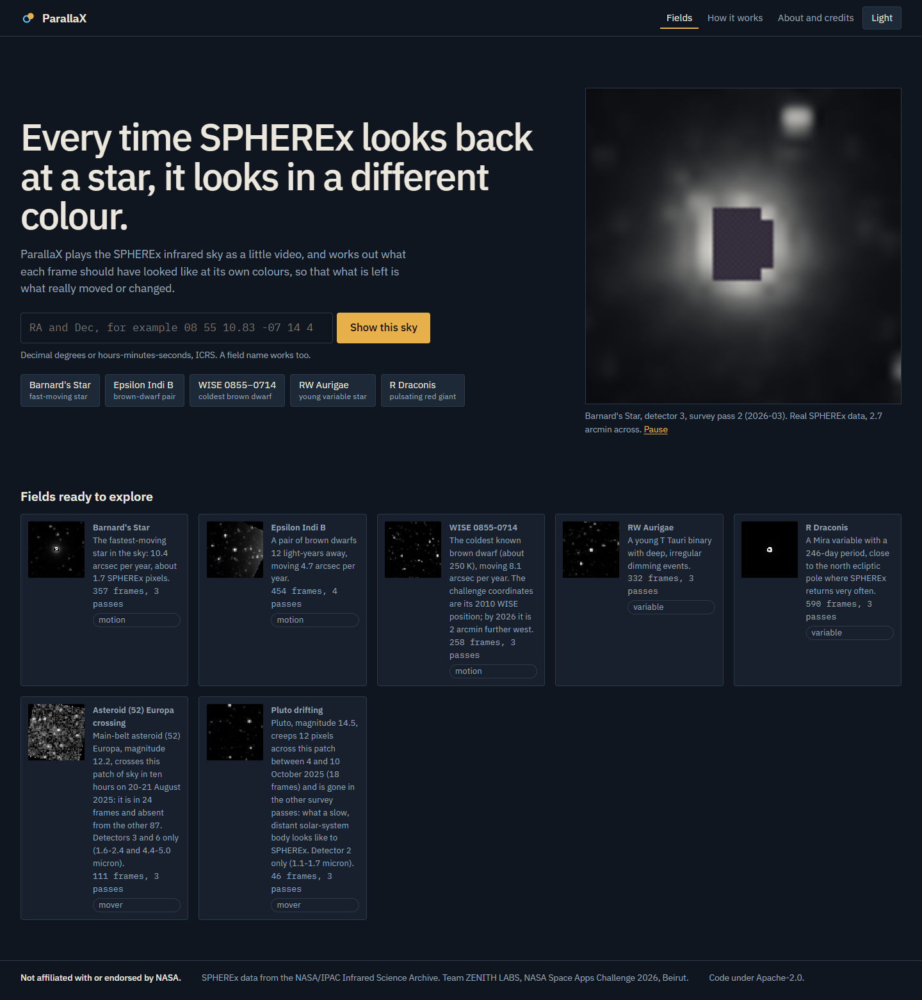

## 2. Opening a patch of sky

* **Pick a ready field.** The home page lists the fields computed in advance, including the
  five test targets of the challenge: Barnard's Star, Epsilon Indi B, WISE 0855-0714, RW
  Aurigae and R Draconis.
* **Type coordinates.** The box takes right ascension and declination in decimal degrees
  (`133.795 -7.245`) or in hours, minutes and seconds (`08 55 10.83 -07 14 42.5` or
  `08h55m10.831s -7d14m42.53s`). A field name such as `barnard` works too. Press "Show this
  sky".
* **Anywhere else on the sky.** If your coordinates are outside the ready fields, the page
  tells you how many times SPHEREx photographed that spot and offers to fetch the images
  live, in your browser, from NASA's public archive. Choose the detectors and the size, read
  the estimated download, and press "Fetch N images live". The pictures appear as they
  arrive and you can stop at any time.

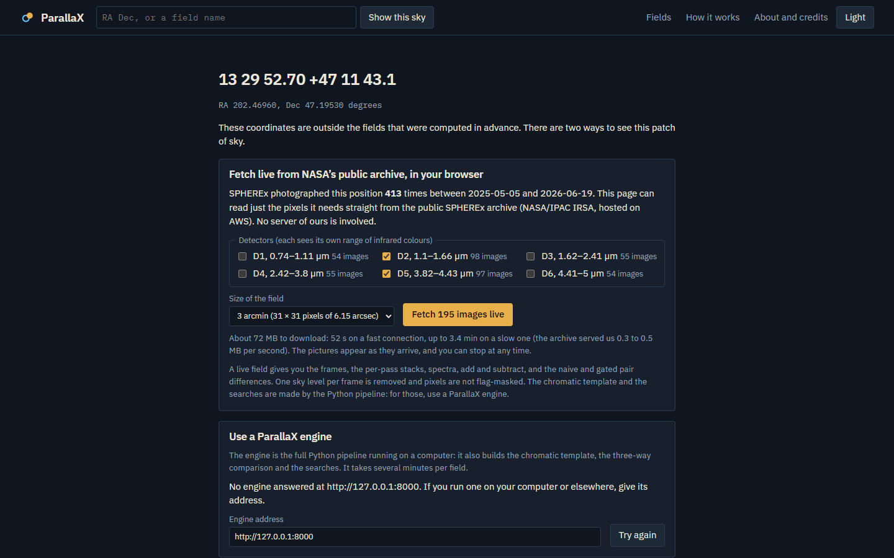

## 3. The screen

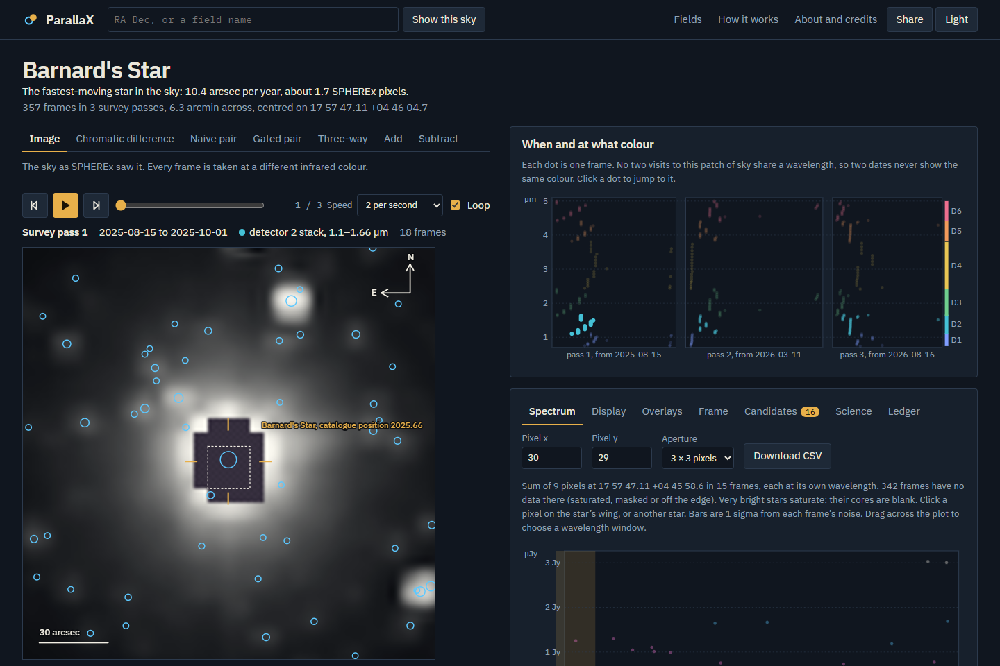

**Left: the sky.** North is up and east is left, as on a star chart. Under the picture a
line of numbers follows your mouse: sky position, pixel, the wavelength at that pixel, and
the brightness. The scale bar shows one arcminute.

**The player.** Play or pause (Space), step one picture (arrow keys), speed, loop. Under it
the label says what you are seeing: the date, the detector, the wavelength, the survey pass.

**"Sequence"** chooses what the player steps through:

* *By survey pass (stacks)*: one clean, averaged picture per pass and detector. Passes are
  six months apart, so this is the best way to see a nearby star move. Choose one detector to
  blink just the passes.
* *Every frame, in time order*: each single exposure. Use it for things that appear in one
  picture only, such as asteroids.

**Right, top: "When and at what colour".** Each dot is one picture: left to right is time
(one box per survey pass), bottom to top is wavelength, colour is the detector. Look at it
once and the main difficulty is obvious: no two dots share a height. Click a dot to jump to
that picture.

**Right, bottom: the panels.** Spectrum, Display, Overlays, Frame, Candidates, Science,
Ledger. They are described below.

## 4. The seven views

The row of tabs above the picture chooses the view. Each has a keyboard shortcut.

| View (key) | What it shows | Use it to |
|---|---|---|
| **Image** (I) | The sky as SPHEREx saw it | Blink and watch |
| **Chromatic difference** (C) | The picture minus what an unchanging sky would look like at exactly this picture's colours, predicted from the other survey passes | See what really changed; this is the method ParallaX adds |
| **Naive pair** (N) | The picture minus the nearest picture from another pass in the same detector, ignoring colour | See the problem: stars leave false signal |
| **Gated pair** (G) | The picture minus a picture from another pass whose colour agrees within half a bandwidth | See the usual fix |
| **Three-way** (T) | The same picture differenced all three ways on one scale | Compare the methods directly |
| **Add** (A) | A stack of any pictures you choose | Go deeper, for faint things |
| **Subtract** (S) | One selection minus another | See a moved star as a bright and a dark lobe |

In the difference views, orange means brighter than expected, blue means fainter, and the
scale is in units of the noise ("sigma"): 5 means five times the typical random scatter.

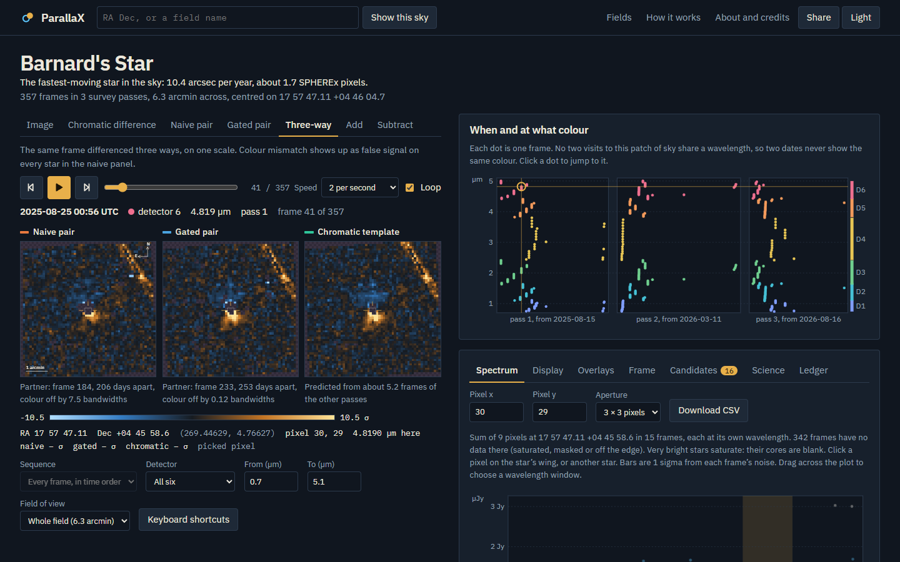

In the three-way picture above, read the line under each panel. The naive partner was taken
206 days earlier or later and is "off by 7.5 bandwidths" in colour: it is a different
colour of light altogether. The gated partner is off by only 0.12 bandwidths. The chromatic
template has no partner; it is "predicted from about 5.2 frames of the other passes".

## 5. How to see a star move

Take Barnard's Star.

1. Open the field. It starts in Image view with the sequence "By survey pass".
2. Choose one detector (for example D2) and a small field of view (2 arcmin), then press
   play. The player now blinks one stack per pass. The star is saturated, so its core is a
   blank square, but its glow shifts north against the fixed stars.
3. The amber cross marks where the Gaia catalogue says the star should be on that date. It
   moves with the star.
4. Switch to **Subtract**. Choose A = pass 3 and B = pass 1, same detector. A star that did
   not move disappears. Barnard's Star leaves a bright lobe to the north, where it is now,
   and a dark lobe to the south, where it used to be.

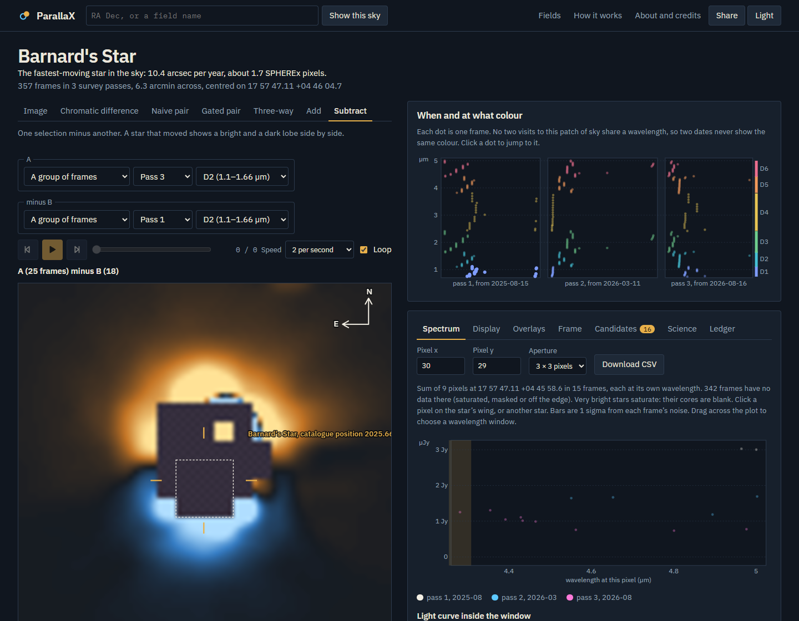

That two-lobe pattern, bright on one side and dark on the other, is the signature of
motion. The pipeline measures the shift: 1.65 pixels over three passes, which gives 10.21 +-
0.26 arcseconds per year against the catalogue's 10.36.

## 6. How to see a star change brightness

Take RW Aurigae, a young star that dims and brightens irregularly.

1. Open the field and click the star. The **Spectrum** panel plots the brightness of that
   pixel in every picture against the wavelength of that picture, coloured by survey pass.
   This spectrum is built on the spot from the pictures you are looking at.
2. If the passes trace different curves, the star changed. Drag across the plot to choose a
   narrow wavelength window; the **light curve** under it then compares like with like.
3. "Download CSV" saves the measurements.

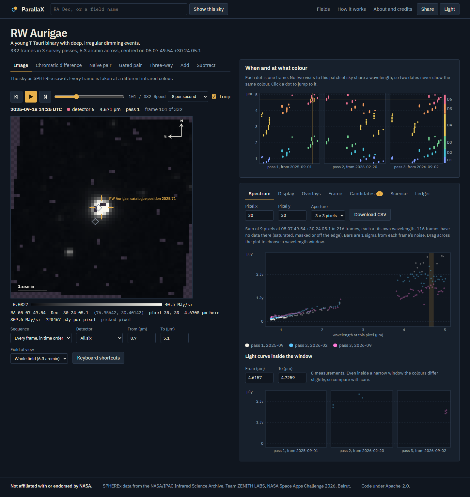

A warning that the app also gives: comparing brightness at two different wavelengths tells
you about the star's colour, not about change. Always compare inside a narrow window. For
RW Aurigae the pipeline finds that between September 2025 and September 2026 the star became
0.37 magnitude brighter at the shortest wavelengths and 0.76 magnitude fainter at the
longest, while a nearby control star stayed constant to 0.005 magnitude.

## 7. Real or not? A field guide to residuals

When you look at a difference picture you will see blobs. Most are not discoveries. Here is
how to sort them.

### A real mover (asteroid, comet, dwarf planet)

* It is in **one place per picture** and in a different place in the next visit, along a
  straight line.
* It is still there in the exposure of the same detector about two minutes later, almost in
  the same place.
* It is bright in the Image view too, not only in the difference.
* Turn on the overlay "Known solar-system objects in this frame": almost everything SPHEREx
  can see moving in a single picture is already catalogued, and the label will sit on it.

Two fields let you practise on real movers. "Asteroid (52) Europa crossing" holds an
asteroid that crosses the field in ten hours: it is in 24 of the 111 pictures and absent
from the rest. "Pluto drifting" holds Pluto creeping 12 pixels in 6.4 days. Open either,
set the sequence to "Every frame, in time order" and step with the arrow keys. The green
label is where JPL Horizons predicts the object as seen from SPHEREx itself; the measured
positions agree with it to a few hundredths of a pixel.

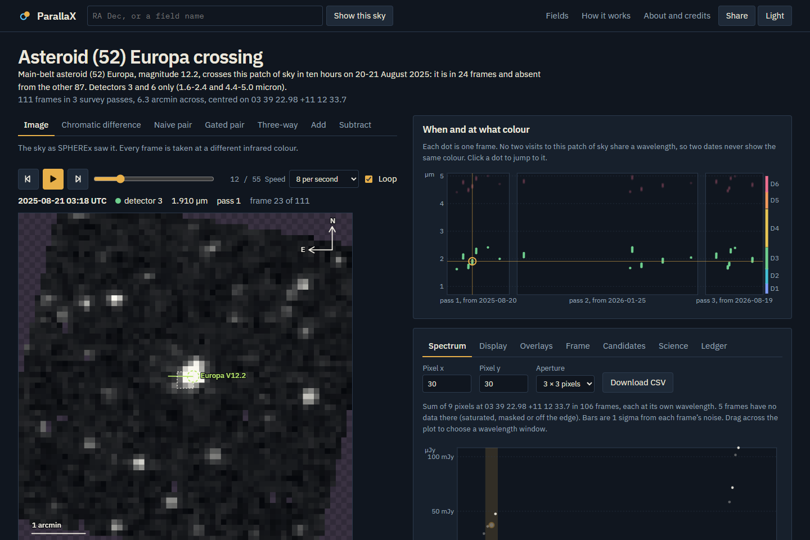

### A star with proper motion

* A **bright lobe and a dark lobe side by side**, at the same star in every picture.
* The pair is clearest in Subtract or in the Gated pair. The catalogue marker moves along the
  line from the dark lobe to the bright one.
* The shift is tiny: one or two pixels for the fastest stars over the survey so far.

### A variable star

* A residual of **one sign** centred exactly on a star: all bright or all dark, with no
  second lobe.
* It keeps that sign through a whole pass and may flip in another pass.
* The spectrum panel shows the passes on different curves.

### A cosmic ray or hot pixel

* **One or two very sharp pixels**, often extremely bright, sharper than any star.
* Present in one picture and **gone in the exposure two minutes later**. SPHEREx exposes each
  position several times in a row, so this check is almost always available.
* The pipeline applies this test itself and calls such a detection an "artifact". On the
  first 202 frames of Barnard's field it removed 14 of 17 single-picture "movers" this way.
* Live fields are not cleaned of these in single frames. The per-pass stacks reject them.

### A colour residual

* It sits **exactly on a catalogued star** (turn on the Gaia overlay) and it is one-signed.
* It appears in the **Naive pair** and shrinks or vanishes in the Gated pair and the
  Chromatic difference. That is the whole point of the Three-way view.
* Turn on the overlay "Wavelength mismatch with the partner frame": where the tint is
  strong, the two pictures were taken in different colours and nothing there can be trusted.

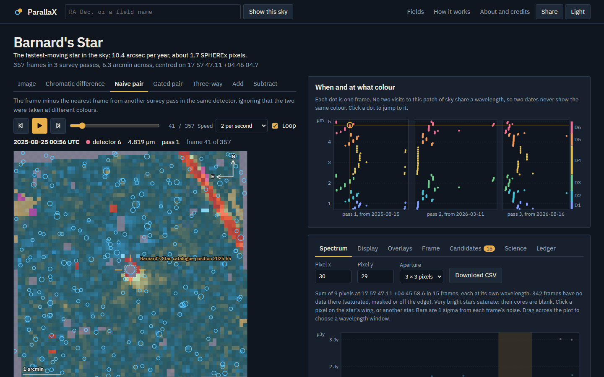

### A pixel-sampling residual

* A small **bright-and-dark speckle on a bright star**, different in every picture.
* It happens because SPHEREx pixels are larger than the star images: the share of a star's
  light that falls in its peak pixel changes by about a quarter from one exposure to the
  next. It is not motion, although it can look like a tiny two-lobe pattern.
* Tell it from real motion by consistency: real motion points the same way in every picture
  and grows from pass to pass; the speckle points anywhere.

### A saturated star or bad pixel

* A **blank square** at the core of a very bright star, or grey blocks. Turn on "Pixel
  flags" to see what the archive marked.
* Residuals around a blank core are unreliable.

| What you see | Most likely |
|---|---|
| New spot, one picture only, razor sharp, gone two minutes later | cosmic ray |
| New spot, star-like, there two minutes later, elsewhere next visit, labelled | known asteroid |
| Same, but not labelled | check again: faint or fast objects can be missing from the overlay |
| Bright and dark lobes, same direction in every picture | star with proper motion |
| One-signed blob on a star, only in the naive view | colour residual |
| One-signed blob on a star in all three views | the star changed brightness |
| Speckle on a bright star, different every time | pixel sampling |

## 8. The panels on the right

* **Spectrum.** Click any pixel. Choose the aperture (one pixel, 3 x 3 or 5 x 5). The text
  tells you in how many pictures that spot had data. Bars are one sigma.
* **Display.** Stretch (asinh, linear, log), colour map, brightness limits, "Hold these
  limits" to stop the brightness flickering while blinking, smooth or exact pixels (key X).
* **Overlays.** Catalogue position of the target; measured position in each pass; Gaia DR3
  stars moved to the date of the picture; CatWISE infrared sources; known solar-system
  objects; pixel flags; wavelength mismatch; detections; linked candidates.

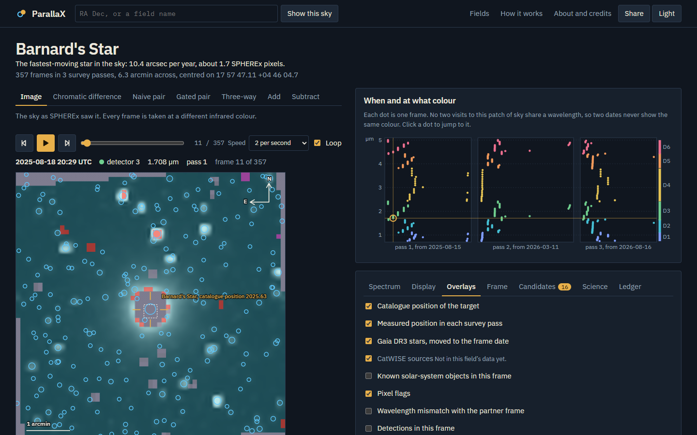

* **Frame.** Details of the current picture: date, detector, wavelength and bandwidth,
  noise, the archive file it came from, its partners.
* **Candidates.** Groups of detections the pipeline linked: repeated two-lobe detections at
  one star (ids starting with D), repeated one-signed detections (V), and straight-line
  movers. Click an id to jump to it. "No match" under "Known object" means no catalogued
  solar-system object was predicted there; it does not mean a discovery.
* **Science.** What the pipeline measured for this target, with the catalogue value next to
  it.
* **Ledger.** The measured comparison of the three difference methods on this field: usable
  frames, false detections, depth, and curves showing how faint an artificial test source
  each method can find.

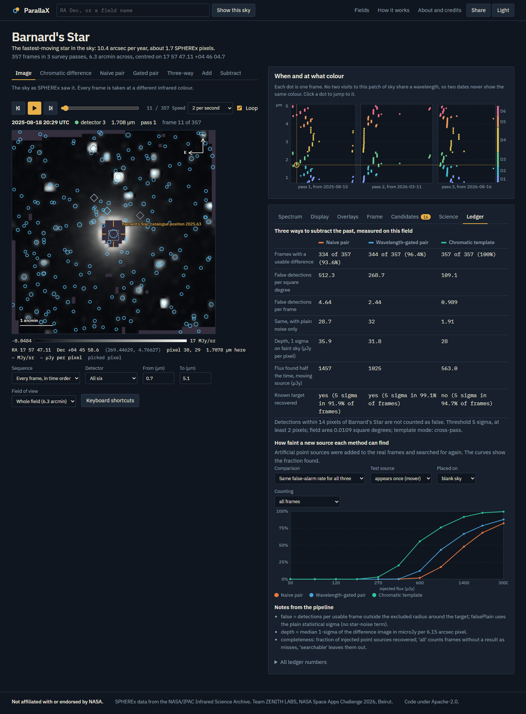

## 9. Sharing and embedding

The address bar always describes exactly the view you are looking at. The **Share** button
gives that link and a ready-made piece of HTML that embeds the picture and its player in
another page. Adding `embed=1` to any link hides everything but the picture and the player.

## 10. Live fields: what is different

A field fetched live in the browser gives you the frames, the per-pass stacks, spectra, Add,
Subtract and the naive and gated pair differences. It does not have the chromatic
difference, the ledger, candidates or the catalogue overlays: those are made by the Python
pipeline. One sky level per picture is removed and bad pixels are not masked, so expect more
cosmic rays in single frames. To get the full treatment for a new position, run a ParallaX
engine on your own computer (`parallax serve`) and the page will offer to use it.

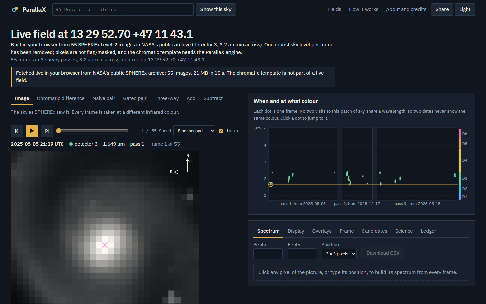

## 11. Keyboard shortcuts

| Key | Action |
|---|---|
| Space | play or pause |
| Left, Right | step one picture (with Shift: ten) |
| Home, End | first, last |
| [ and ] | slower, faster |
| L | loop on or off |
| P | by survey pass, or every frame |
| 0 to 6 | detector (0 = all six) |
| I C N G T A S | the seven views |
| X | smooth or exact pixels |
| ? | show this list in the app |

## 12. Things to keep in mind

* Planet X is the motivation for the challenge, not something this tool claims to find. A
  real Planet Nine would be far too faint for single SPHEREx pictures.
* The faint brown dwarf WISE 0855-0714 cannot be seen in any single picture. It appears only
  when the pictures of detectors 5 and 6 are stacked.
* The brightest stars saturate: Barnard's Star and R Draconis have blank cores in nearly
  every picture.
* Everything the tool labels (classes, candidates, measurements) is the output of the
  ParallaX code, not a NASA product. If something looks new, treat it as a question, and see
  [CONTRIBUTING.md](../CONTRIBUTING.md) for how to report it.

Not affiliated with or endorsed by NASA.
